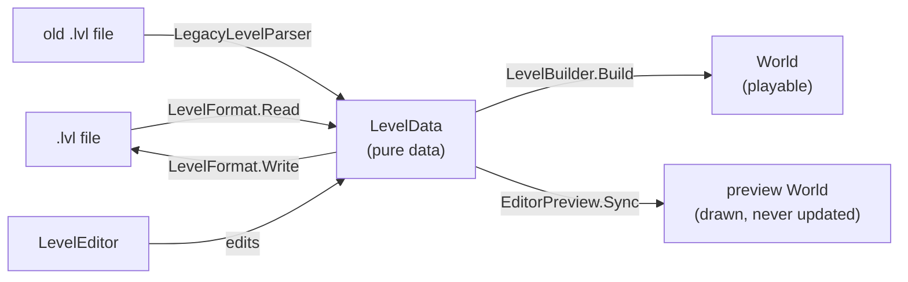
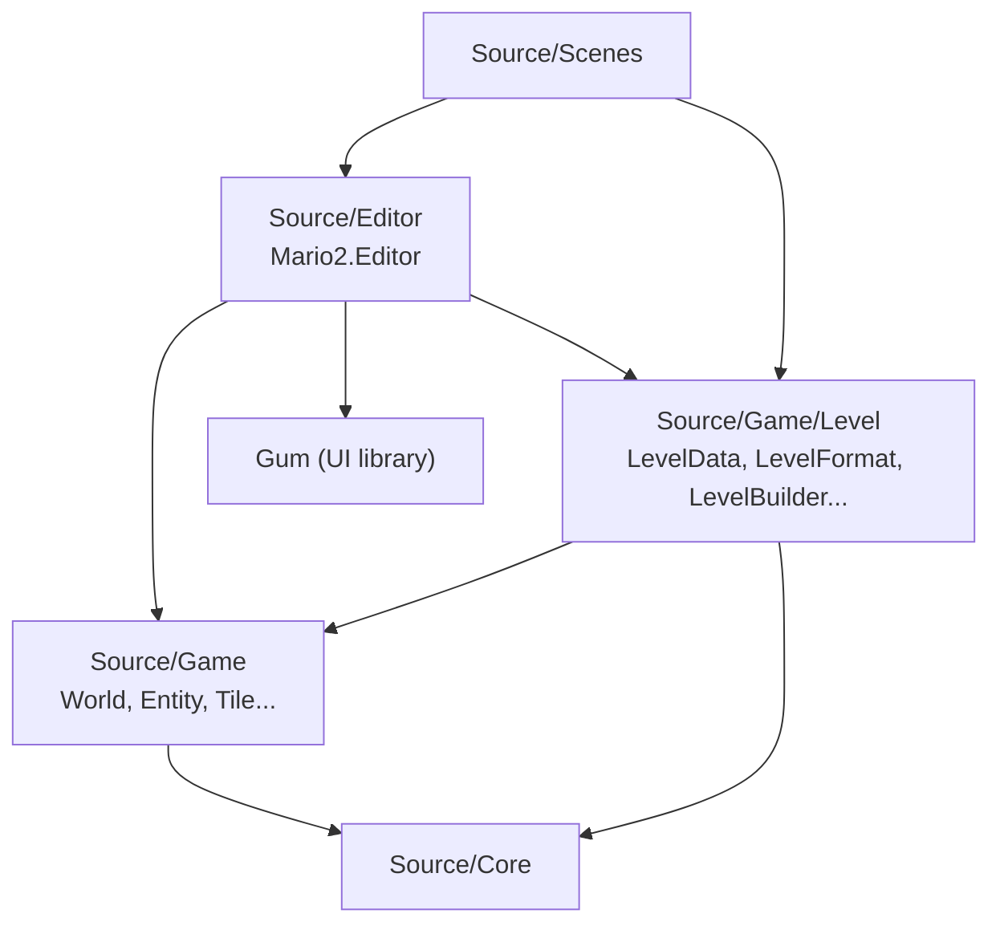
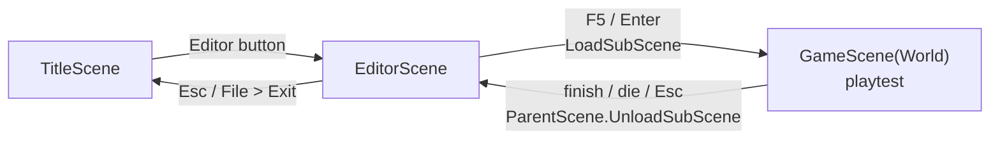
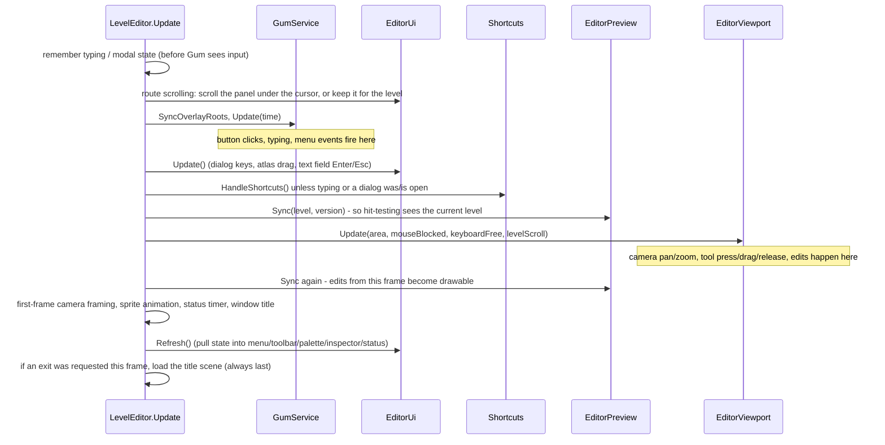

# 1. Architecture

## The core idea: levels are data

The old editor edited a live `World`: real `Tile` and `Entity` objects with gameplay code inside. To save, every entity serialized itself (`SaveCustomData`), and the editor reached into gameplay classes (`Tile.Rule`, `Entity.OnEditorMove`, `ActiveScene is EditorScene`...).

The new design puts a **pure data model** in the middle:



- **`LevelData`** is what files store, what the editor edits, and what undo snapshots copy. It contains no gameplay objects, only immutable *specs* (`TileSpec`) and *placements* (`EntityPlacement`).
- **`LevelBuilder`** turns `LevelData` into a playable `World`. It's the only place where data becomes gameplay objects, used by the campaign, the title backdrop and editor playtests alike. A level therefore plays identically however it was loaded.
- **The editor never runs gameplay.** To draw the level it builds a *preview* world from the same data (`EditorPreview`), but only ever draws it.

## Layers and dependency direction



The arrows are one-way. **Nothing in `Source/Game` (including `Source/Game/Level`) references the editor.** Outside the scenes, the only reference to editor code is `Source/Core/Disk/GameSettingsLoader.cs`, which stores the editor's recent files (`EditorPrefs.RecentFiles`) in the settings file.

The only editor-awareness left in gameplay code:

| Where | What | Why |
|-------|------|-----|
| `World.IsEditorPreview` | an init-only flag | marks the editor's preview world |
| `Entity.Draw` | calls `DrawEditor()` when `World.IsEditorPreview` | invisible markers (warp pipe arrows, MIDW sign...) show icons in the editor only |
| `Scene.DrawsToWindow` | virtual bool | the editor draws at window resolution instead of the 256×224 virtual screen |

## Scenes

The game is a stack of scenes (`Source/Scenes/Scene.cs`). A scene can host a **sub-scene**. While one is active, the parent isn't updated or drawn (`Scene.Update`/`Draw` forward to `SubScene`).



- `EditorScene` (in `Source/Scenes/EditorScene.cs`) is deliberately thin. It creates a `LevelEditor` in `OnLoad` and forwards `Update`/`Draw`/`Unload` to it. `OnSubSceneUnload` (a playtest ended) calls `LevelEditor.OnReturnFromPlaytest`, which shows the cursor and silences music.
- `Scene.ActiveLeaf` walks down the sub-scene chain to the scene that's actually running. `Game.Draw` checks `ActiveScene.ActiveLeaf.DrawsToWindow`. The editor returns `true`, so `Game` lets it call `BeginDrawing`/`EndDrawing` itself. During a playtest the leaf is `GameScene`, so the normal virtual-screen path is used.

## One editor frame, start to finish

`Game.Update` → `EditorScene.OnUpdate` → `LevelEditor.Update`, then `Game.Draw` → `EditorScene.OnDraw` → `LevelEditor.Draw`. The **order inside `LevelEditor.Update` matters**. Each step relies on the previous one:



Then `Draw`: clear → `Viewport.Draw()` (the level, clipped to the viewport) → `GumService.Default.Draw()` (all UI on top) → `EndDrawing`.

Why is exiting deferred to the end? `ExitToTitle` is called from *inside* this update (a shortcut, a menu click, a dialog button). Loading the title scene right there would unload the editor while the rest of its update still had to run. That was a real bug: the tail of the frame wrote the level name back into the window title after the unload had reset it. So `ExitToTitle` only sets `_exitRequested`, and the scene switch is the last statement of `Update`.

Why the two "remember" flags at the top? If you press **Enter** in a text field, Gum handles it during `GumService.Update` and the field commits and loses focus. Checked *after* that, nobody would be typing any more, and the same Enter would also fire the **Play** shortcut. Capturing `typing` and `modal` before Gum runs makes the key belong to the UI for the whole frame. See [Input & shortcuts](07-input-and-shortcuts.md).

## Ownership map

`LevelEditor` owns everything. Most classes take a `LevelEditor` in their constructor and reach siblings through it (e.g. a tool calls `Editor.Document`, `Editor.Preview`).

```
LevelEditor
├── Document : EditorDocument      the LevelData + undo/redo + file path + dirty flag
├── Selection : EditorSelection    selected entity ids / player start / tile / region
├── Preview : EditorPreview        drawable mirror of the document
├── Camera : EditorCamera          pan/zoom + coordinate conversion
├── Viewport : EditorViewport      input routing + all level drawing
├── Ghost : GhostWorld             scratch world for translucent brush previews
├── Tools : Select/Brush/Rect/Erase/Pick
├── Tool, Brush, Clipboard         current state
└── Ui : EditorUi                  Gum views (created in Load, after Gum is initialized)
```

`LevelEditor` is split into partial files by concern:

| File | Contents |
|------|----------|
| `LevelEditor.cs` | fields, construction, `Load`/`Unload`, the frame loop, tool/brush switching, `FeetAt`/`SnapFeet` snapping, window title |
| `LevelEditor.Edit.cs` | every editing operation (paint, place, move, delete, copy/paste, property edits, columns) |
| `LevelEditor.Files.cs` | new/open/save/save-as, unsaved-changes prompt, exit, **playtest** |
| `LevelEditor.Shortcuts.cs` | keyboard shortcuts, the Escape cascade, arrow keys, undo/redo wrappers |

## What was removed

- ImGui / rlImgui (package, global usings, `imgui.ini` handling, `res/default.ini`, `Helper.GuiDisabledButton`).
- `Source/Game/Editor/**` (the old editor), `WorldLoader.cs` (the old loader).
- From gameplay classes: `Entity.IsEditorSaveable/IsEditorInteractable/OnEditorMove/OnEditorDelete/SaveCustomData/LoadCustomData` and their overrides, `Tile.Rule`, and `World.Draw`'s `editor` parameter with its editor-only drawing branch.

The per-entity save/load logic didn't disappear. It moved into data: the property schema in `EntityCatalog` (chapter 2) and the legacy decoders in `LegacyLevelParser` (chapter 3).
