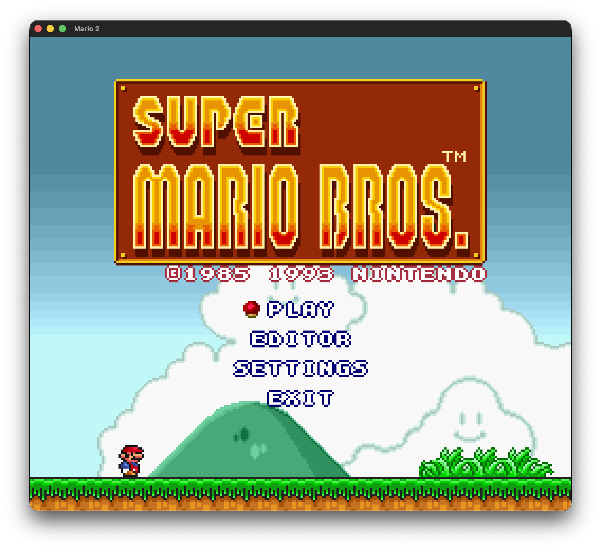
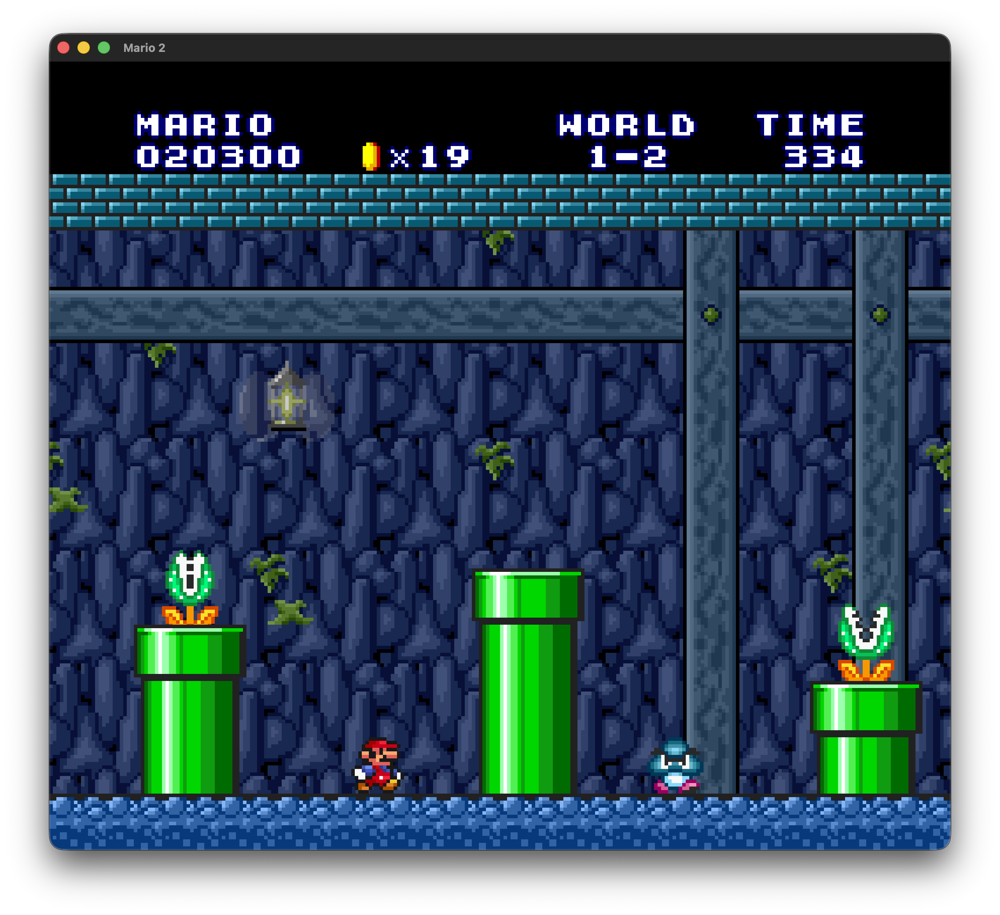
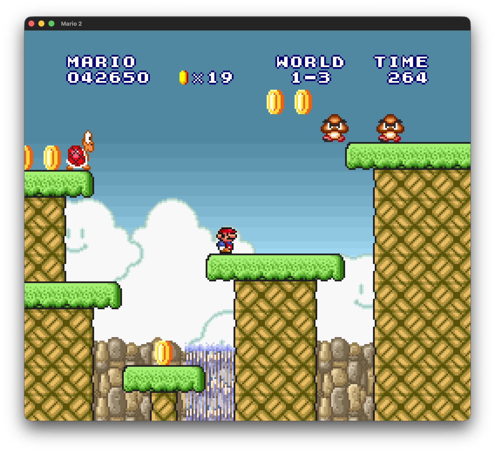
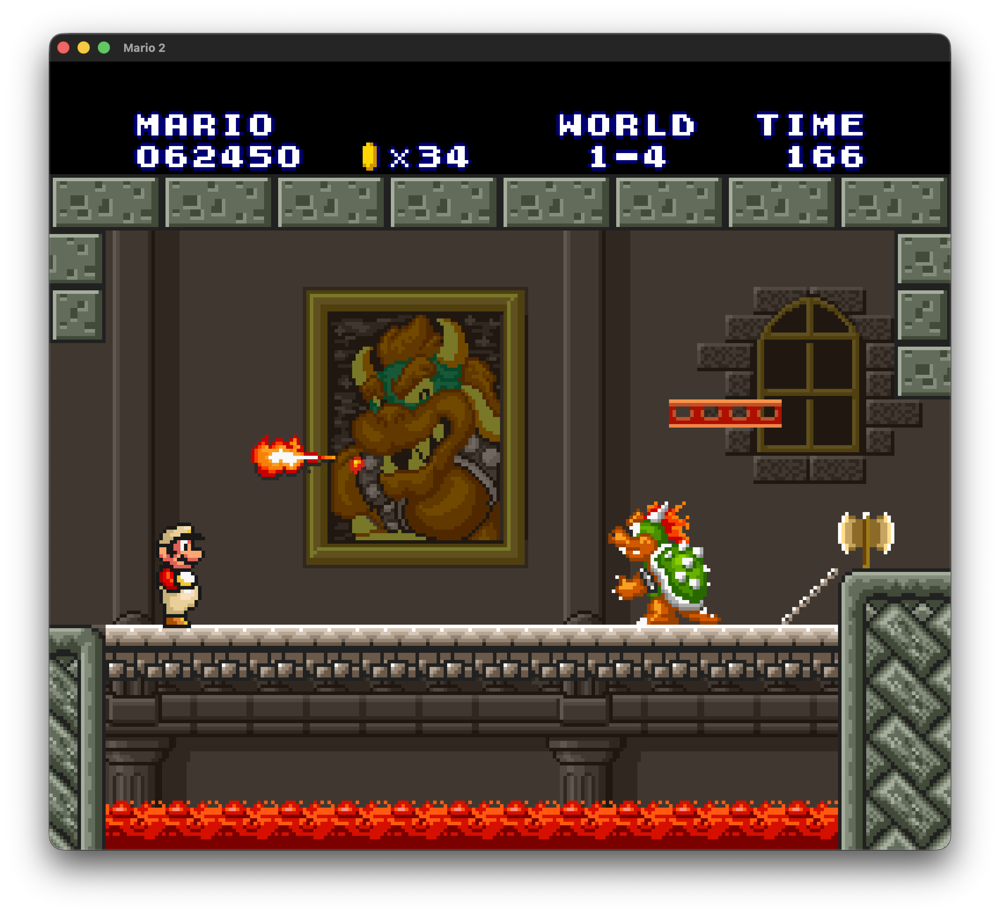
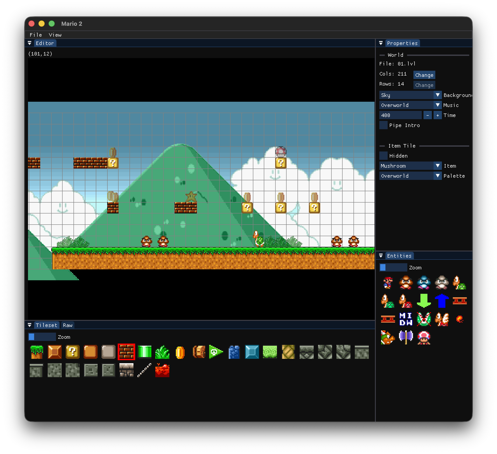
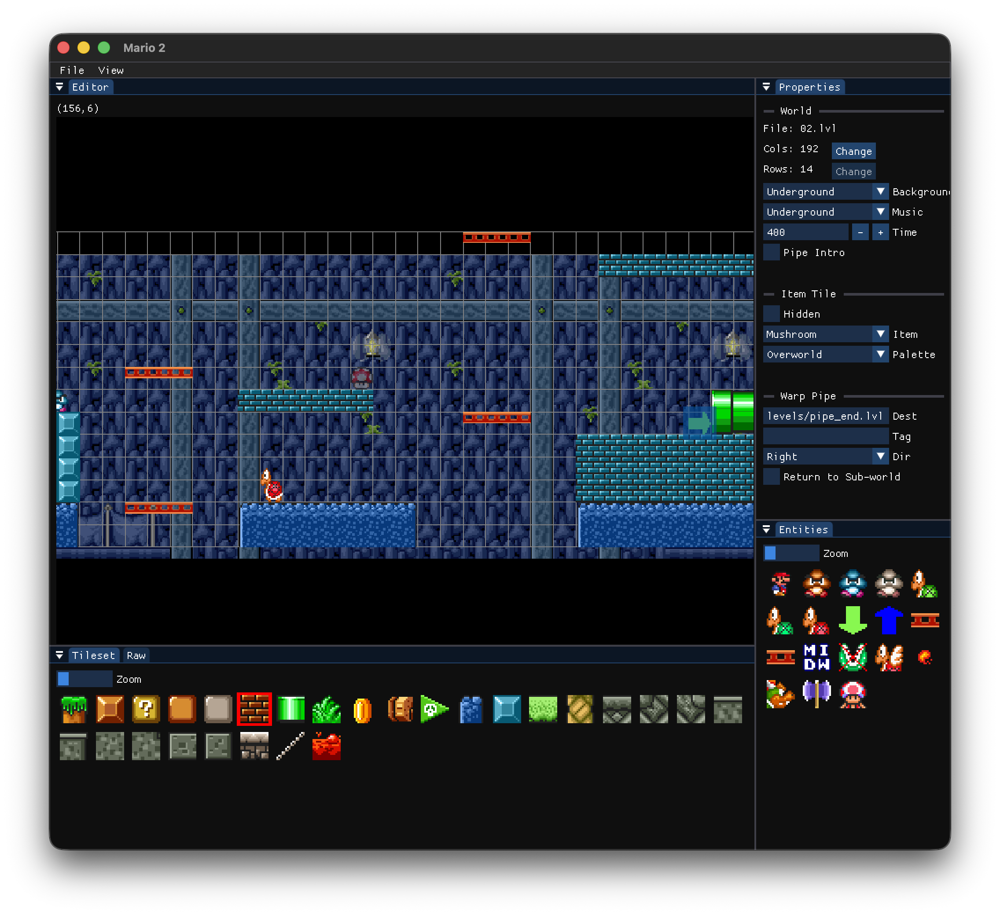

# 🍄 Super Mario Bros. Clone & Level Editor

> A highly accurate recreation of Super Mario Bros. 1 (World 1) featuring *Super Mario All-Stars* graphics, built in C# using Raylib. Includes a fully integrated, robust level editor.

This project was built from the ground up as a portfolio piece to showcase clean software architecture, modular game design, and tool development. The gameplay physics were tuned side-by-side with an emulator to achieve a nearly 1:1 authentic feel.

---

## 📸 Gallery

### Gameplay

  
  

  
  

### Integrated Level Editor

  
  

---

## ✨ Features

*   **World 1 Complete:** A fully playable, pixel-perfect(ish) recreation of World 1.
*   **1:1 Physics & Mechanics:** Developed alongside an emulator to ensure Mario's momentum, jumping, and collision feel authentic.
*   **16-Bit Graphics:** Utilizes the upgraded sprites and tilesets from *Super Mario All-Stars*.
*   **Built-in Level Editor:** A comprehensive, custom-built level editor accessible directly from the main menu, even in release builds! You can paint tiles, place entities, and test levels on the fly without leaving the game.
*   **Zero-Spaghetti Architecture:** Strongly decoupled, highly structured C# codebase meant to be easily readable, scalable, and maintainable.
*   **Cross-Platform:** Developed on macOS with full support for Windows. The C# and Raylib foundation ensures it runs seamlessly across different operating systems.

---

## 🛠️ Tech Stack & Development

*   **Language:** C#
*   **Framework:** [Raylib](https://www.raylib.com/) (via [Raylib-cs](https://github.com/raylib-cs/raylib-cs) version 7.0.2) — Cross-platform rendering and window management.
*   **UI (Editor):** [rlImgui-cs](https://github.com/raylib-extras/rlImGui-cs) version 3.2.0 (Dear ImGui bindings for Raylib) and [NativeFileDialogSharp](https://github.com/milleniumbug/NativeFileDialogSharp) version 0.6.0-alpha for native OS file picking.
*   **100% Hand-Coded:** Every system, physics calculation, and editor tool was engineered entirely from scratch. Zero AI was used to write the code—I wanted to demonstrate a genuine, deep understanding of game architecture. (Full disclosure: I did use AI to help me write this very README, though!)

---

## 🚀 Getting Started

### 🎮 Just Want to Play?
You don't need to compile the code! The built-in level editor and base game are fully playable out of the box. Head over to the [Releases](https://github.com/szepad/SuperMario/releases) tab and download the latest version for your operating system (macOS `.app` or Windows `.exe`).

### 💻 Building from Source
If you want to explore the code or compile it yourself:

**Prerequisites:**
*   .NET 10.0 SDK *(Cross-platform for both macOS and Windows)*
*   *macOS Developers:* The project utilizes a custom MSBuild target (`CreateMacAppBundle`) that triggers after the `Publish` step for `osx` runtime identifiers. This automatically builds the `.app` structure (`Contents/MacOS` and `Contents/Resources`), copies the `Info.plist` and `icon.icns`, and runs `chmod +x` to grant execution permissions.

**Running the project:**
1. Clone this repository:
   `git clone https://github.com/szepad/SuperMario.git`

2. Navigate to the project directory:
   `cd SuperMario`

3. Build and run the project:
   `dotnet run`

---

## 🎮 Controls

### Gameplay
*   **Move:** `Arrow Keys`
*   **Jump:** `A`
*   **Sprint/Fireball:** `D`

### Level Editor
*   **Playtest Level:** `Enter`
*   **Exit to Title Menu:** `Escape`
*   **Pan Camera:** Use the `Middle Mouse Button`, or the `Arrow Keys`
*   **Fast Pan:** Hold the `Left Shift` key while panning with the keyboard to increase camera speed.
*   **Zoom Camera:** Scroll the `Mouse Wheel`.
*   **Place/Select:** Use `Left Click` to place a tile/entity or to select an existing entity.
*   **Erase/Delete:** Use `Right Click` to delete the tile or entity under your cursor.
*   **Move Selected Entity:** Once an entity is selected, use the `Arrow Keys` to move it around the map.

*(Note: File operations like New, Open, and Save are located in the top menu bar).*

---

## ⚖️ Disclaimer & Copyright

This is a non-profit, educational fan project created solely for portfolio and programming demonstration purposes.

**Super Mario Bros.** and all related assets, characters, sounds, and graphics are the sole property of **Nintendo Co., Ltd.** I do not claim any ownership over these assets. This project is not affiliated with, endorsed by, or sponsored by Nintendo.